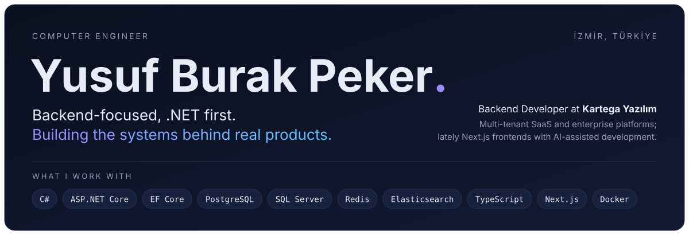
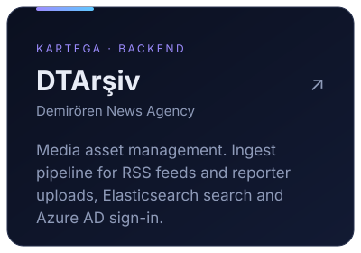
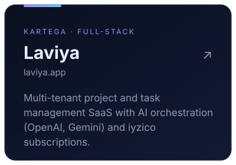
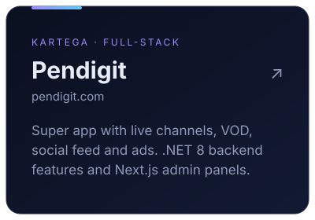
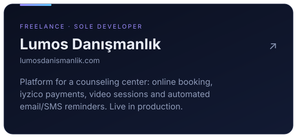
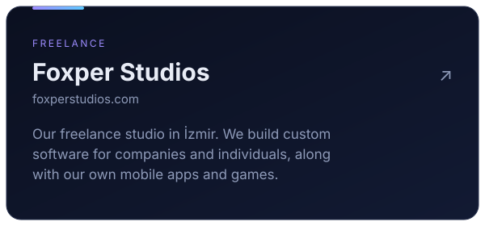
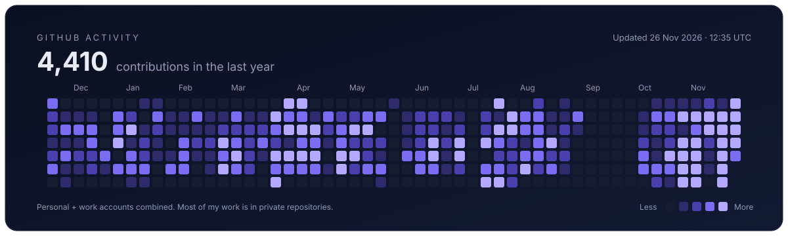

<picture></picture>

Profile in plain text

**Yusuf Burak Peker** · Computer Engineer · İzmir, Türkiye 
Backend Developer at Kartega Yazılım. I build multi-tenant SaaS and enterprise platforms with .NET, and lately Next.js frontends with AI-assisted development.

**What I work with:** C# · ASP.NET Core · EF Core · PostgreSQL · SQL Server · Redis · Elasticsearch · TypeScript · Next.js · Docker

**Selected work:**

- [DTArşiv](https://pkryusuf.tech/projects/dtarsiv) (Demirören News Agency) – media asset management: ingest pipeline, Elasticsearch search, Azure AD sign-in
- [Laviya](https://laviya.app) – multi-tenant project and task management SaaS with AI orchestration and iyzico subscriptions
- [Pendigit](https://pendigit.com) – super app with live channels, VOD, social feed and ads
- [Lumos Danışmanlık](https://lumosdanismanlik.com) – freelance, sole developer: booking, payments, video sessions, reminders
- [Foxper Studios](https://foxperstudios.com) – our freelance studio building custom software, apps and games

**GitHub activity** (personal + work accounts): refreshed daily by a GitHub Action ([activity card](./assets/activity.svg)).

**Recognition:** Mercedes-Benz Otomotiv StarHack'21 – 1st place with [CarGoo](https://pkryusuf.tech/projects/cargoo)

**Contact:** [Email](mailto:pekeryusufburak@gmail.com) · [LinkedIn](https://www.linkedin.com/in/pkryusuf/) · [pkryusuf.tech](https://pkryusuf.tech)

